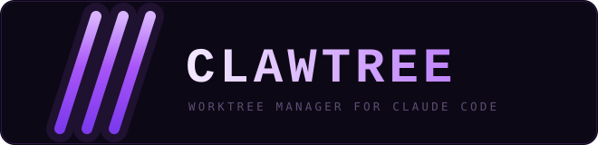
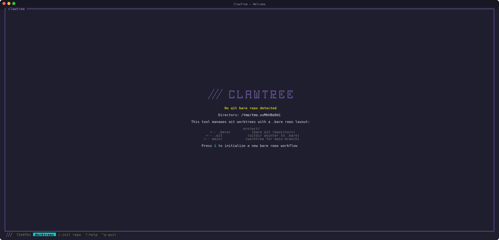
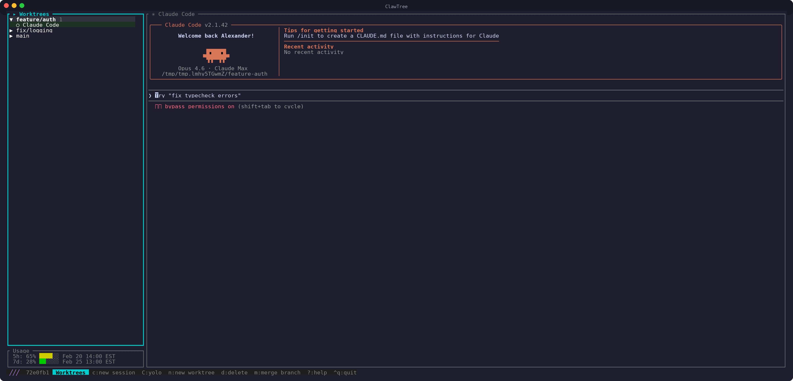
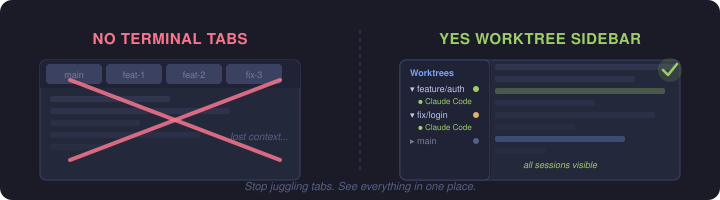
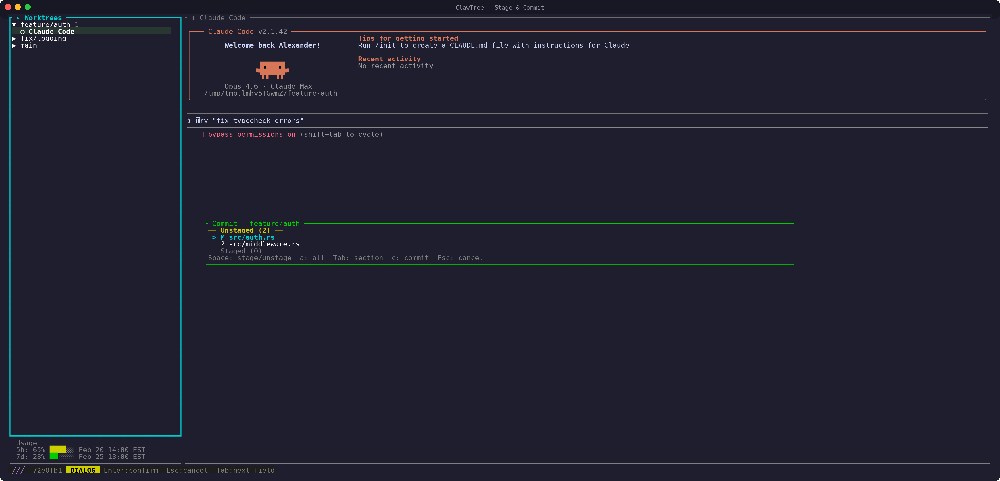
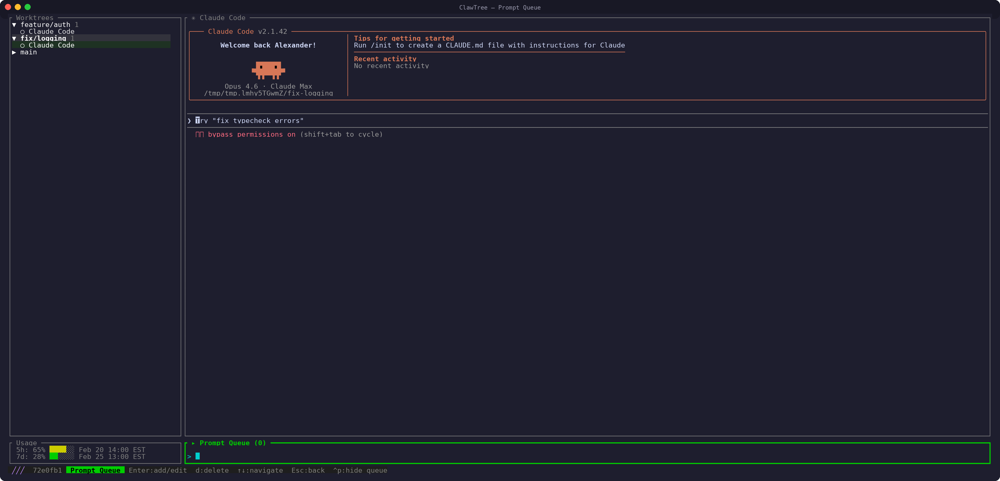
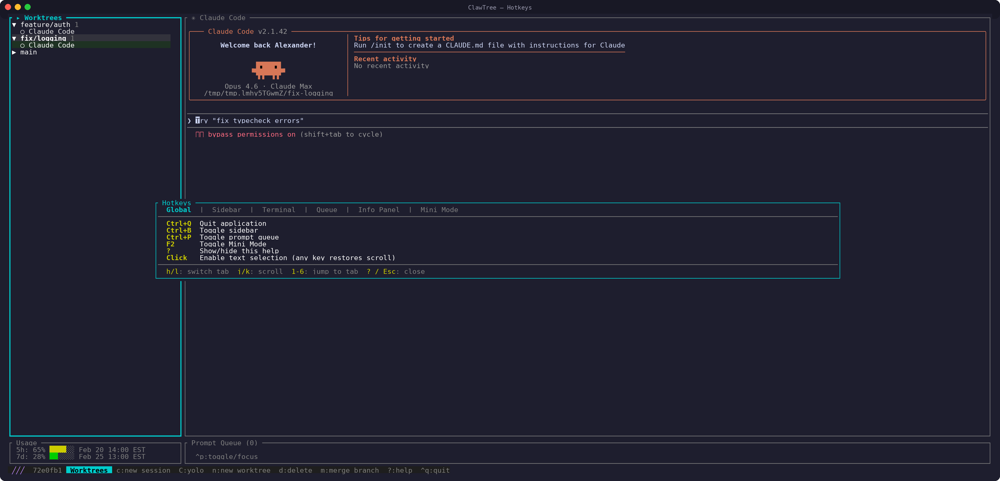

<div align="center">



<br>

**One terminal, multiple Claude sessions — all visible at a glance.**

[](https://github.com/Sorrer/ClawTree/releases/latest)
[](https://github.com/Sorrer/ClawTree/actions/workflows/release.yml)
[](https://www.rust-lang.org/)
[](#platform)
[](LICENSE)

</div>

---

A terminal UI for empowering your parallized usage of claude and git worktrees.


>Behind the Project:
>
>As I have been embracing AI assisted programming, I found myself pushing parallel AI development to the extreme.
>With this, I am stuck cloning repositories for different feature paths, and context swapping between multiple terminal tabs. All in the goal to utilize multiple claude instances and contexts to their fullest extent.
>This has been a rough process that I've been trying to optimize, and this tool has solved my issue.
>You should now be granted with the power of multi-clauding with this toolset!


## Table of Contents

- [Install](#install)
- [Getting Started](#getting-started)
- [Features](#features)
  - [Worktree and Claude Code Management](#worktree-and-claude-code-management)
  - [Git Operations](#git-operations)
  - [Prompt Queue](#prompt-queue)
  - [Mini Mode](#mini-mode)
  - [Terminal & UI](#terminal--ui)
  - [Antigravity CLI (agy)](#antigravity-cli-agy)
  - [Messaging between sessions (MCP)](#messaging-between-sessions-mcp)
  - [Recovering after a crash](#recovering-after-a-crash)
- [Requirements](#requirements)
- [Future Goals](#future-goals)

## Install

```bash
curl -fsSL https://raw.githubusercontent.com/Sorrer/ClawTree/main/install.sh | bash
```

This downloads a pre-built binary for your platform and adds it to your PATH. Supports Linux (x86_64, aarch64) and macOS (Intel, Apple Silicon).

<details>
<summary><strong>Advanced install options</strong></summary>

Install from a **private repo** (requires [GitHub CLI](https://cli.github.com/) authenticated via `gh auth login`):

```bash
gh api repos/Sorrer/ClawTree/contents/install.sh \
  -H "Accept: application/vnd.github.raw" | GITHUB_TOKEN=$(gh auth token) bash
```

Install a specific version:

```bash
curl -fsSL https://raw.githubusercontent.com/Sorrer/ClawTree/main/install.sh | bash -s -- v0.1.2
```

Install to a custom directory:

```bash
CLAWTREE_INSTALL_DIR=/usr/local/bin curl -fsSL https://raw.githubusercontent.com/Sorrer/ClawTree/main/install.sh | bash
```

</details>

## Getting Started

> Make sure claude is installed and accessible

After installation, navigate to your project and run clawtree:

```bash
cd your-project
clawtree
```

If the directory does not contain a `.bare` repo layout, clawtree opens a **welcome screen** with setup options:

<p align="center">
  
</p>

From here you can:

- Press **`i`** to **initialize** a new bare repo workflow — creates the `.bare/` directory structure and your first worktree
- Press **`c`** to **convert** an existing regular git repo into the bare worktree layout (only shown when a `.git` directory is detected)

Once initialized, clawtree opens the main interface where you can browse your worktrees in the sidebar. Press **`n`** to create additional worktrees for new branches. To start a Claude Code session, press **`c`** for regular mode or **`C`** (Shift+C) for yolo mode (`--dangerously-skip-permissions`). Press **`a`** / **`A`** for the same with [Antigravity CLI](#antigravity-cli-agy) (`agy`).

<p align="center">
  
</p>

## Features

### Worktree and Claude Code Management

<p align="center">
  
</p>

- Browse, create, and delete worktrees from a sidebar tree view
- Initialize new bare repos or clone from a remote URL
- Convert existing repos to the bare worktree layout
- Live git status updates per worktree
- Context-aware status indicators — know at a glance when Claude is waiting for input
- Run multiple concurrent Claude Code sessions per worktree, all from a single terminal
- Antigravity CLI (`agy`) sessions alongside them: see [below](#antigravity-cli-agy)

### Git Operations
- Stage, unstage, and commit with AI-generated commit messages
- Branch merging with conflict detection and resolution (VS Code, JetBrains, Claude)
- Push to remote with automatic upstream setup

<p align="center">
  
</p>

### Prompt Queue

Queue up one-shot tasks for Claude to handle sequentially while you focus on other work — great for knocking out a batch of bug fixes or cleanup tasks after completing a big feature.

- Per-session queues that auto-send prompts when Claude is idle
- Add, edit, and delete queued prompts
- Queues persist across restarts

<p align="center">
  
</p>


### Terminal & UI
- Keyboard-driven with vim-style navigation (`j`/`k`, `?` for help)
- Click-and-drag text selection with clipboard support
- URL detection — click to open, `u` to copy
- Scrollback browsing with scrollbar. Works with both Claude Code renderers: with the classic renderer the history comes from tmux scrollback; with the fullscreen (alternate-screen) renderer the wheel, PgUp/PgDn and mouse clicks are forwarded to Claude Code, which scrolls and selects in its own buffer. Set `CLAWTREE_CLASSIC_RENDERER=1` to force the classic renderer for new sessions
- Auto update notifications

<p align="center">
  
</p>

### Antigravity CLI (`agy`)

[Antigravity CLI](https://antigravity.google/docs/cli/overview) is Google's terminal agent, the successor of Gemini CLI. Install it with `curl -fsSL https://antigravity.google/cli/install.sh | bash` and sign in once by running `agy`.

- **`a`** starts `agy` under the selected worktree, project root or location, and **`A`** starts it with `--dangerously-skip-permissions`. Both are also in the right-click menu.
- **Status works the same as for Claude.** The sidebar shows working (spinner), idle (○) and needs input (●: a tool approval or the folder-trust question), and plan mode is highlighted. clawtree passes agy a title command for that session only (`--settings`, never saved to your settings). The pane title then carries agy's state and the conversation's title, and sidebar rows read e.g. `Fix login bug agy`.
- **Crash recovery covers agy too.** clawtree reads the conversation id from the running process (agy holds `~/.gemini/antigravity-cli/presence/<id>.lock`) and the mode from agy's footer. A restored session comes back with `agy --conversation <id> --mode <mode>`, and YOLO sessions keep the flag.
- **Usage:** the Usage panel shows agy's quota (`agy 5h`, `agy 7d`, plus `agy 3p …` for third-party models once used) under Claude's windows. agy hands its quota to clawtree's title hook on every state change. The hook keeps the latest copy in `~/.clawtree/agy-usage.json`, so nothing extra is fetched.
- **Background work:** agy sub-agents and background tasks (`N subagent(s)` / `N task(s)` in its footer) show as *awaiting agents*.
- Per-session context-usage percentages and the rate-limit marker are Claude Code only.

### Messaging between sessions (MCP)

Agent sessions can talk to each other, across agents (Claude Code ↔ agy) and across projects. clawtree ships an MCP server, `clawtree mcp`, with two tools:

| Tool | What it does |
|------|--------------|
| `list_sessions` | Every clawtree agent session on this machine: name, nickname, agent, folder, project and status (`idle`, `working`, `needs_input`, `waiting_on_subagents`). The caller is marked `you`. |
| `send_message(to, message)` | Queue a message for a session (by name or nickname). It is typed into that session's prompt once the session is idle, as `[clawtree message from <name> (<agent> · <folder>) — reply with … to: "<name>"] <message>`, so the receiver can answer the same way. |

Just ask in plain words, e.g. *"ask the agy session in feature-x to review my last commit and send you its findings"*.

To point one agent at another, right-click the other session in the sidebar and choose **Link to Active Session**. A reference to it is typed into the prompt of the session you have open, for example `clawtree session clawtree-main-4 (claude, "Mega titan revamp", main; reach it with …)`. It isn't sent, so you can add *"…work with it via clawtree to finish the boss fight"* and press Enter.

- **Wiring:**
  - Claude sessions clawtree starts get the server through `--mcp-config`, for that session only.
  - agy has no per-session option, so clawtree registers it once with `agy mcp add clawtree <clawtree> mcp`. Undo it with `agy mcp remove clawtree`.
  - Both get a session-only rule that lets the two tools run without an approval prompt.
  - Set `CLAWTREE_NO_MCP=1` to turn the server off.
- **Delivery:** messages wait in `~/.clawtree/mailbox/<session>/`. Each session's own server types its mail in once the session is idle and its screen has settled, never mid-turn and never into a dialog. Sessions started before messaging existed can still *receive*, because the sender's server delivers for them. They can only *send* after they are restarted from clawtree.

### Recovering after a crash

Sessions live in tmux, so they survive closing clawtree, and the next launch reattaches them. tmux itself can't survive a reboot, a WSL VM crash or a killed tmux server, though: when it goes, every session goes with it. That's why clawtree also keeps a **layout manifest** on disk recording which sessions each project had, and rewrites it within a second of any change (spawn, close, rename, worktree removal).

- **Where:** `~/.clawtree/state/<project-path>-<hash>.json`, one file per project. Each entry records the tmux name, the worktree/root/location, Claude or terminal, the nickname, YOLO mode, a terminal's last folder, and the **Claude conversation id**. New sessions are started with `claude --session-id <uuid>`, and clawtree follows the id when it changes (`/clear`, `/resume`).
- **On the next launch**, sessions that are in the manifest but not in tmux are offered in a *Restore previous sessions* dialog. Each Claude session resumes its own conversation (`claude --resume <id>`), and terminals reopen in their last folder.

  | Key | Action |
  |-----|--------|
  | `Enter` | Restore the checked sessions (unchecked ones are discarded) |
  | `a` | Restore all |
  | `space` | Check / uncheck the selected session |
  | `c` | When the conversation had to be guessed, try the next candidate |
  | `d` | Discard all: stop offering them (transcripts are never deleted) |
  | `Esc` | Decide later: offered again next launch |

  Sessions whose worktree no longer exists are listed with their conversation id, so you can `claude --resume <id>` them by hand.
- **From the command line:**
  ```bash
  clawtree restore [dir]            # restore everything, then open the TUI
  clawtree restore --list [dir]     # show restorable / stale / live sessions, change nothing
  clawtree restore --no-tui [dir]   # restore and exit (scripts)
  ```

A session still running in tmux (including one attached by another clawtree) is never offered, and neither is a conversation that's already open under another name or in a `claude` you started yourself, so no conversation is ever run twice. That is checked again right before each restore, in case another clawtree restored it a moment earlier. Diagnostics go to `~/.clawtree/logs/clawtree.log`, which is appended to across launches and rolls over to `clawtree.log.1` at 10 MB. `--cleanup` / `--cleanup-all` also remove the sessions they kill from the manifest. Set `CLAWTREE_SKIP_LAYOUT=1` to turn the manifest off, and `CLAWTREE_TMUX_SOCKET=<name>` to run all of clawtree's tmux sessions on a private server (`tmux -L <name>`). That's handy for testing recovery: `tmux -L <name> kill-server` simulates a crash.

### Platform
- Linux (x86_64, aarch64) and macOS (Intel, Apple Silicon)
- WSL integration: open Windows Terminal tabs with `w`/`W` keys
- Graceful signal handling (SIGINT, SIGTERM, SIGHUP) with guaranteed terminal restoration

## Requirements

| Dependency | Required | Purpose |
|---|---|---|
| **git** | Yes | Worktree management, staging, commits, merges |
| **claude** (Claude Code CLI) | Yes | AI assistant sessions spawned per worktree |
| **agy** (Antigravity CLI) | Optional | Antigravity sessions (`a` / `A`) |
| **tmux** | Yes | Session persistence and reconnection across restarts |
| **wt.exe** | Optional | Windows Terminal tab integration (WSL only) |

<details>
<summary><strong>Development</strong></summary>

### Building from Source

Everything from the requirements above, plus Rust (edition 2021, 1.56+) and a C compiler.

```bash
./build.sh
# or manually:
cargo build --release
```

```bash
./run.sh
# or manually:
./target/release/clawtree
```

### Testing

Clawtree includes unit tests, integration tests for git operations, and an end-to-end test suite. CI runs automatically on push and PRs via GitHub Actions (unit/integration tests, E2E tests, and clippy lints).

```bash
# Run all tests
cargo test

# Run E2E tests (requires tmux and a release build)
cargo build --release
tests/e2e_test.sh
```

</details>

## Future Goals

- Enhance UI/UX to support **everyone's** workflows
- Support other agentic CLIs like Codex and Gemini CLI
